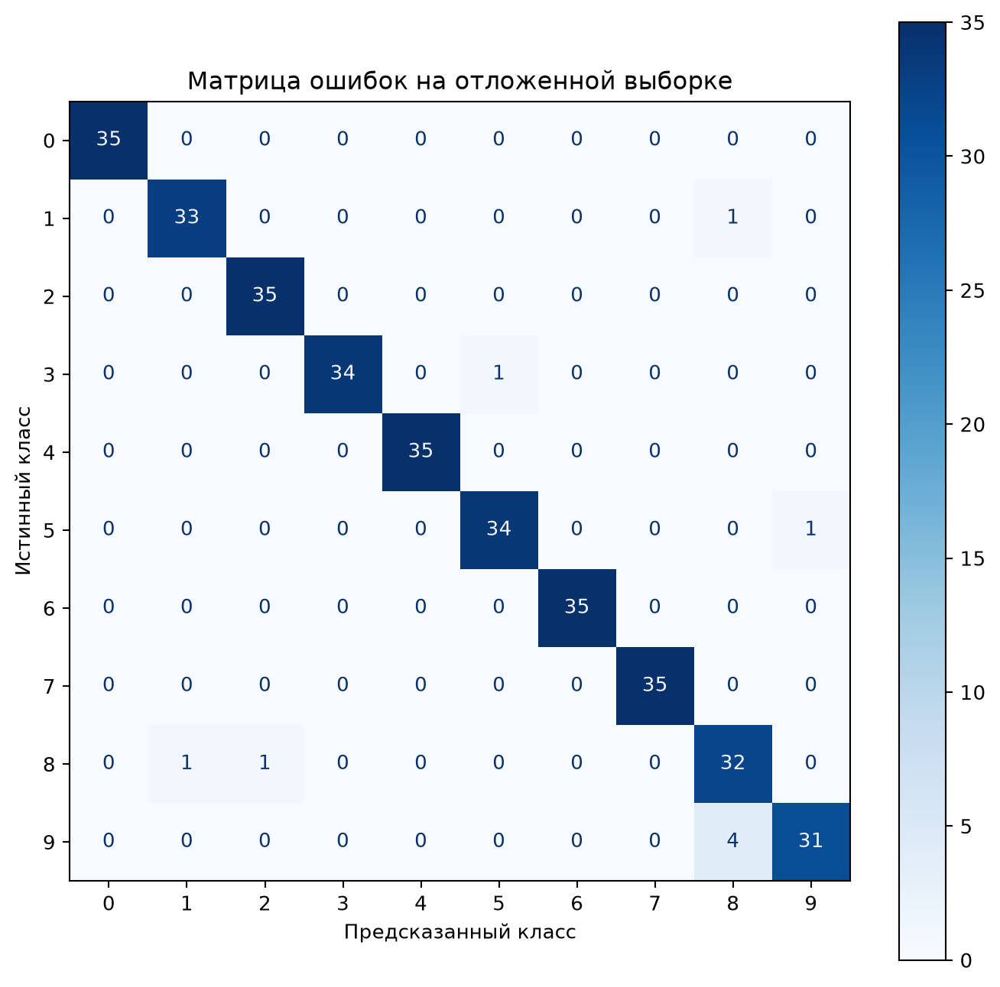
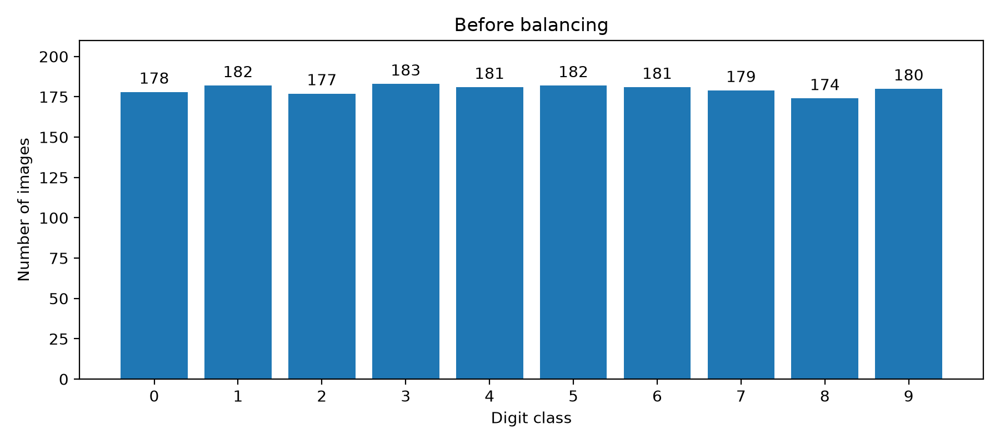
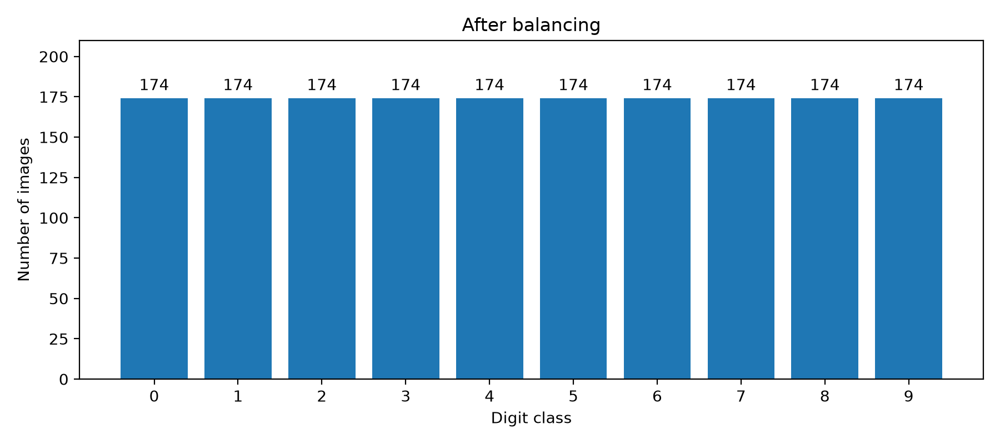
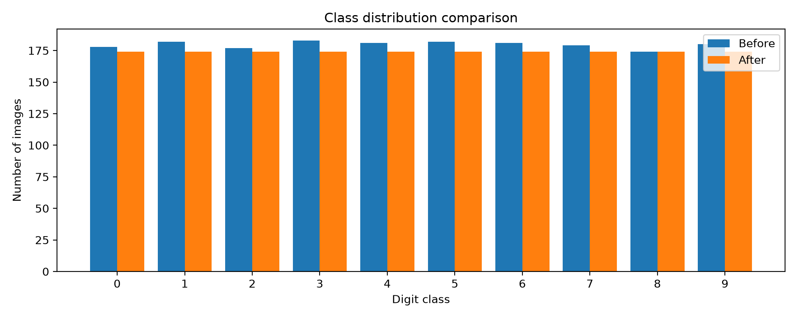
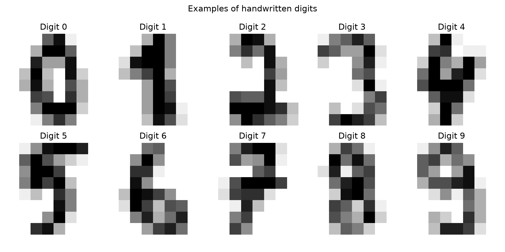

<!-- LABS_OVERVIEW_BEGIN -->
# Киберустойчивость систем искусственного интеллекта

**Единый учебный проект по компьютерному зрению: от защищённого окружения до оценки качества и устойчивости ML-модели.**

## Лабораторные работы

| Этап | Тема | Основные материалы |
|:--|:--|:--|
| **№ 1** | Подготовка защищённого окружения и исследование набора рукописных цифр | Описание **ниже на этой странице**, [ноутбук № 1](notebooks/01_digits_analysis.ipynb), [графики](reports/figures/) |
| **№ 2** | Построение базовой модели, оценка качества и проверка устойчивости входов | **[Описание, результаты и 7 рисунков](README_LAB2.md)**, [ноутбук № 2](notebooks/02_baseline_and_robustness.ipynb), [метрики](metrics/baseline.json), [тесты](tests/) |

## Основные результаты второго этапа

| Accuracy на тесте | Macro-F1 | Тестовая выборка | Автоматические тесты |
|:--:|:--:|:--:|:--:|
| **97,41 %** | **0,9740** | **348 изображений** | **33/33 пройдены** |



*Матрица ошибок классификатора из ЛР № 2. Полный разбор результатов, значения Precision/Recall/F1 по классам и эксперимент с искажениями приведены в [описании второй лабораторной](README_LAB2.md).*

---

**Ниже сохранено исходное описание лабораторной работы № 1 с её иллюстрациями.**
<!-- LABS_OVERVIEW_END -->

# Лабораторная работа № 1. Защищённое окружение для проекта машинного обучения

**Дисциплина:** «Киберустойчивость систем искусственного интеллекта»  
**Университет:** ИТМО, факультет безопасности информационных технологий (ФБИТ)  
**Выполнил:** Серко Сергей Игоревич, 2-й курс, группа N4270  
**Проверяет:** Керимбай Акылжан  
**Направление проекта:** компьютерное зрение (Computer Vision)  
**Тема:** подготовка защищённой среды и набора рукописных цифр для последующего исследования устойчивости классификатора.

## 1. Цель и задачи

**Цель работы** — подготовить воспроизводимую рабочую среду на Linux, ограничить риски несанкционированного доступа и изменения данных, выбрать открытый набор данных и исследовать его распределение до дальнейшего обучения модели.

В рамках лабораторной работы выполнены следующие действия:

1. Установлена Ubuntu в виртуальной машине Oracle VirtualBox, организована работа от непривилегированного пользователя.
2. Настроен удалённый доступ по SSH-ключу ED25519 с запретом удалённого входа `root` и парольной SSH-аутентификации.
3. Настроен межсетевой экран UFW, изучены прослушиваемые порты и отключена ненужная служба Avahi.
4. Подготовлено Python-окружение и зафиксированы зависимости; выполнена проверка `pip-audit`.
5. Создан Git-репозиторий с исключением служебных и конфиденциальных файлов.
6. Выбран открытый набор рукописных цифр, сохранены исходная и строго сбалансированная версии.
7. Построены графики распределения классов и выполнена проверка целостности CSV по SHA256.
8. Составлена мини-модель угроз для инфраструктуры и данных проекта.

**Граница работы:** обучение нейросети, измерение точности классификации и проверка устойчивости к состязательным искажениям относятся к следующим этапам проекта. В этой лабораторной **обученная модель не заявляется**.

## 2. Описание выбранной задачи

Будущая модель получает изображение рукописной цифры размером **8 × 8 пикселей** и определяет один из **10 классов (0–9)**. Изображение представлено **64 числовыми признаками**, содержащими интенсивности пикселей от **0 до 16**. Метка класса хранится в столбце `target`.

Потенциальная область применения — автоматизированное распознавание рукописных числовых записей. В следующих работах планируется исследовать, как шум, повреждение или целенаправленное изменение изображения влияют на качество распознавания.

## 3. Источник и характеристики датасета

**Название:** Optical Recognition of Handwritten Digits.  
**Проверяемая версия:** набор `load_digits()` из библиотеки `scikit-learn`, связанный с исходным набором UCI.

- [Описание набора данных в UCI Machine Learning Repository](https://archive.ics.uci.edu/dataset/80/optical+recognition+of+handwritten+digits)
- [Документация scikit-learn: `load_digits`](https://scikit-learn.org/stable/modules/generated/sklearn.datasets.load_digits.html)

Используется **конкретная версия из scikit-learn на 1797 объектов**, а не весь исходный набор UCI, который имеет иной объём.

| Характеристика | Исходный набор | Рабочий набор |
|---|---:|---:|
| Файл | `data/digits_original.csv` | `data/digits.csv` |
| Количество изображений | 1797 | 1740 |
| Число классов | 10 | 10 |
| Число признаков | 64 | 64 |
| Дополнительный столбец | `target` | `target` |
| Размер изображения | 8 × 8 | 8 × 8 |
| Объектов в одном классе | от 174 до 183 | **ровно 174** |
| Тип данных | числовые интенсивности пикселей и целочисленная метка | тот же |

### Строгая балансировка классов

По дополнительному требованию преподавателя создан набор с **абсолютно одинаковым числом объектов** в каждом классе. Использовано *случайное сокращение большинства классов* (undersampling) **без возвращения и без генерации искусственных изображений**, с `random_state=42`.

| Цифра | До балансировки | После балансировки |
|---:|---:|---:|
| 0 | 178 | 174 |
| 1 | 182 | 174 |
| 2 | 177 | 174 |
| 3 | 183 | 174 |
| 4 | 181 | 174 |
| 5 | 182 | 174 |
| 6 | 181 | 174 |
| 7 | 179 | 174 |
| 8 | 174 | 174 |
| 9 | 180 | 174 |
| **Всего** | **1797** | **1740** |

Из рабочего набора исключено **57 объектов**, а оригинальный CSV сохранён отдельно. Каждый класс теперь занимает **ровно 10%** набора. Балансировка исключает разницу частот классов, но **сама по себе не доказывает улучшение точности** будущей модели.

## 4. Графики и анализ данных

**Рисунок 1 — Распределение рукописных цифр до балансировки.**



**Рисунок 2 — Строго равное распределение: 174 изображения каждого класса.**



**Рисунок 3 — Сравнение количества объектов до и после балансировки.**



**Рисунок 4 — Примеры изображений цифр из набора данных.**



Графики формируются из фактических CSV-файлов. Их исходный код и выполненные результаты размещены в `notebooks/01_digits_analysis.ipynb`.

## 5. Структура репозитория

```text
lab1-cyber-resilience/
├── data/
│   ├── digits_original.csv          # исходный набор — 1797 объектов
│   └── digits.csv                   # рабочий набор — 1740 объектов
├── integrity/
│   ├── datasets.sha256              # эталонные SHA256 двух CSV
│   └── hashes.txt                   # дополнительная запись хэшей из Notebook
├── notebooks/
│   └── 01_digits_analysis.ipynb     # анализ, графики, проверки
├── reports/
│   ├── SECURITY_REPORT.md           # мини-модель угроз и состояние защиты
│   ├── pip_audit.txt                # результат проверки зависимостей
│   ├── evidence/                    # результаты команд Linux, SSH, UFW, портов
│   └── figures/                     # изображения результатов анализа
├── src/
│   └── .gitkeep                     # резерв для будущего исходного кода
├── models/
│   └── .gitkeep                     # резерв для будущих обученных моделей
├── tests/
│   └── .gitkeep                     # резерв для будущих автоматических тестов
├── .gitignore                       # исключения для Git
├── requirements.txt                 # список зависимостей Python
└── README.md                        # описание проекта и запуск
```

Папки `src`, `models` и `tests` пока содержат только `.gitkeep`: это **заготовки для следующих лабораторных**, а не отсутствующие результаты лабораторной № 1. Git не хранит полностью пустые каталоги, поэтому используется `.gitkeep`.

## 6. Установка и запуск анализа

Ниже приведён способ воспроизведения на Ubuntu 24.04 при наличии Python 3 и доступа к сети.

### 6.1. Получение проекта

```bash
git clone https://github.com/Serega-Rodriguez-Sand-Kingovich/lab1-cyber-resilience.git
cd lab1-cyber-resilience
```

### 6.2. Создание виртуального окружения

```bash
sudo apt install -y python3-venv
python3 -m venv .venv
source .venv/bin/activate
python -m pip install -r requirements.txt
```

Проверка активного Python:

```bash
python --version
```

В выполненной лабораторной использовалась Ubuntu **24.04.5 LTS** и Python **3.12.3**. Точные версии остальных установленных пакетов зафиксированы в `requirements.txt`; воспроизведение зависит от доступности совместимых пакетов.

### 6.3. Проверка сохранённого датасета

**Важно: сначала проверяйте сохранённые хэши, не пересоздавая эталон.**

```bash
sha256sum -c integrity/datasets.sha256
```

Ожидается:

```text
data/digits_original.csv: OK
data/digits.csv: OK
```

Если показано `FAILED`, нельзя просто создать новый эталон и считать проблему исправленной: следует выяснить причину расхождения.

Проверка количества объектов в каждом классе:

```bash
python -c "import pandas as pd; d=pd.read_csv('data/digits.csv'); c=d['target'].value_counts().sort_index(); print(c); assert len(c)==10 and (c==174).all() and len(d)==1740"
```

### 6.4. Работа в JupyterLab

```bash
jupyter lab --no-browser --ip=127.0.0.1 --port=8888
```

Откройте JupyterLab в браузере через локальный доступ или заранее настроенный SSH-туннель, затем файл:

`notebooks/01_digits_analysis.ipynb`

Для полной проверки выберите **Restart Kernel and Run All Cells**. При запуске из папки `notebooks/` относительные пути к данным начинаются с `../data/`.

Не публикуйте токен Jupyter, появляющийся в ссылке для входа.

## 7. Защита окружения и результаты проверок

| Средство | Что выполнено | Где подтверждается |
|---|---|---|
| Пользователь Linux | Работа под `mluser`, не под `root` | `reports/evidence/security_checks.txt` |
| SSH | Ключ ED25519, запрет `root`, парольной и интерактивной аутентификации | `reports/evidence/final_network_check.txt` |
| UFW | `deny incoming`, `allow outgoing`, `limit 22/tcp`, журналирование | `reports/evidence/final_network_check.txt` |
| Анализ портов | Сравнение слушающих портов до и после отключения Avahi | `reports/evidence/ports_before_cleanup.txt`, `ports_after_cleanup.txt` |
| Docker | Установка и успешный запуск тестового контейнера `hello-world` | материалы проверки окружения |
| `pip-audit` | В момент выполненной проверки: `No known vulnerabilities found` | `reports/pip_audit.txt` |
| SHA256 | Проверка обоих CSV с результатами `OK` | `integrity/datasets.sha256`, `reports/evidence/security_checks.txt` |
| Git | Созданы репозиторий и `.gitignore`, исключена `.venv` | история коммитов и `.gitignore` |

**Ограничения:** отсутствие найденных уязвимостей при одном запуске `pip-audit` не гарантирует безопасность в будущем. SHA256 обнаруживает несовпадение файла с эталоном, но не доказывает доверенность исходного источника. Для большей защиты эталонные суммы следует хранить независимо от изменяемого набора данных; отдельная копия вне виртуальной машины оформляется дополнительно.

## 8. Мини-модель угроз

Мини-модель угроз представлена в `reports/SECURITY_REPORT.md`. Она рассматривает как минимум пять групп активов:

| Защищаемый актив | Основная угроза | Мера защиты |
|---|---|---|
| SSH и учётные записи | Подбор пароля, неправомерный доступ | Вход по ключу, запрет root и SSH-паролей, UFW |
| Датасет | Подмена изображений или меток | SHA256, сохранение исходного CSV, контроль изменений |
| Git-репозиторий | Случайная публикация секретов | `.gitignore`, проверка добавляемых файлов |
| Зависимости Python | Использование пакетов с известными уязвимостями | `pip-audit`, фиксированный список зависимостей |
| Сетевые службы | Использование ненужных открытых портов | UFW, `ss -tulpn`, отключение Avahi |

Не все риски устранены полностью. В частности, сохранение контрольных сумм рядом с данными не защищает от одновременной подмены данных и эталона, а `.gitignore` не удаляет секреты из прежних коммитов.

## 9. Как воспроизвести балансировку отдельно

Следующая команда создаёт **новые копии в отдельном каталоге `reproduction/`**, не перезаписывая файлы `data/` и эталонные суммы:

```bash
python - <<'PY'
from pathlib import Path
from sklearn.datasets import load_digits

source = load_digits(as_frame=True).frame
balanced = source.groupby("target", group_keys=False).sample(
    n=174, random_state=42
)

out = Path("reproduction")
out.mkdir(exist_ok=True)

source.to_csv(out / "digits_original.csv", index=False)
balanced.to_csv(out / "digits.csv", index=False)

print("Оригинал:", len(source))
print("После балансировки:", len(balanced))
print(balanced["target"].value_counts().sort_index())
PY
```

Ожидается 1797 исходных строк и 1740 рабочих строк — **по 174 в каждом из 10 классов**. При использовании других версий библиотек нужно отдельно проверить побайтовое совпадение результатов; контрольный эталон нельзя автоматически заменять.

## 10. Итоги и дальнейшая работа

В результате лабораторной подготовлена среда для последующих экспериментов по устойчивости системы распознавания цифр. Выполнены настройка удалённого доступа и сетевой защиты, аудит Python-зависимостей, выбор открытого датасета, его строгая балансировка, визуальный анализ, контроль целостности SHA256 и составление мини-модели угроз.

**Полученный результат — защищённая инфраструктурная и информационная основа ML-проекта, а не готовый обученный классификатор.**

В дальнейшем планируется реализовать классификатор, разделить данные на обучающую и проверочную выборки, измерить качество распознавания и исследовать ошибки при искажении входных изображений.

---

**Автор:** Серко Сергей Игоревич, ИТМО, группа N4270.  
**Репозиторий:** [lab1-cyber-resilience](https://github.com/Serega-Rodriguez-Sand-Kingovich/lab1-cyber-resilience).
