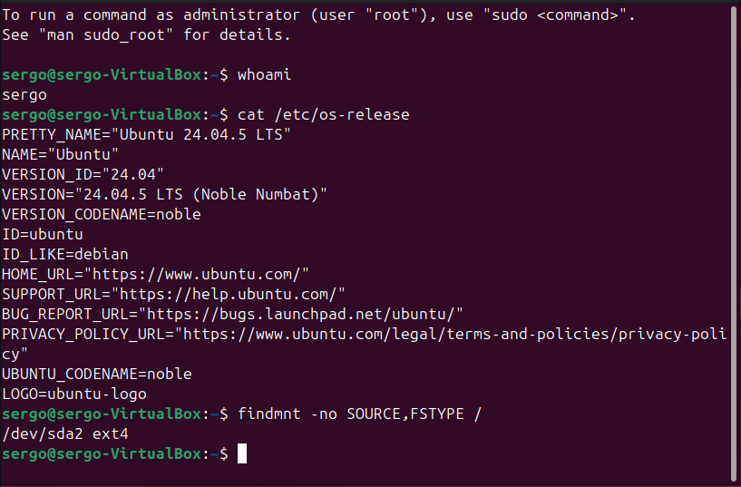
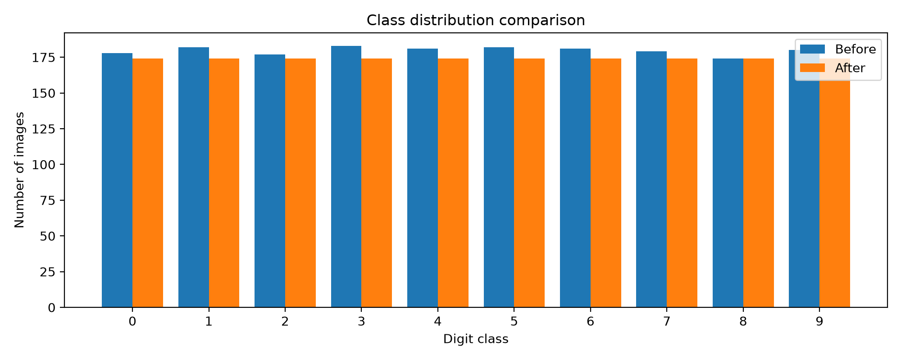
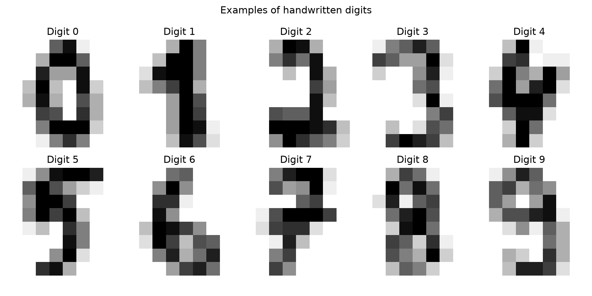

# Лабораторная работа 1. Окружение и данные

Серко Сергей Игоревич, группа N4270. Университет ИТМО, 2026.

На первом этапе подготовлена рабочая среда для ML-проекта, выбран открытый набор данных, проверены его структура и целостность. Направление — компьютерное зрение: классификация изображений рукописных цифр от 0 до 9.

## Ubuntu и инструменты

Работа выполнялась на Windows с виртуальной машиной `CyberAI-Ubuntu` в Oracle VirtualBox.

| Параметр | Использованное значение |
|---|---|
| ОС виртуальной машины | Ubuntu Desktop 24.04.5 LTS |
| Ресурсы | 2 vCPU, 4 096 МБ RAM |
| Виртуальный диск | VDI, 52,77 ГБ с динамическим выделением |
| Основной пользователь разработки | `mluser` |
| Python | 3.12.3, виртуальное окружение `.venv` |
| Контроль версий | Git 2.43.0 |
| Контейнеры | Docker и Docker Compose; проверен `hello-world` |
| Среда для экспериментов | JupyterLab |

Установка выполнялась на виртуальный диск, а не на системный раздел Windows. Работа с зависимостями, данными и Git велась от отдельного пользователя `mluser`; административные команды выполнялись через `sudo`.



*Проверка системы после установки Ubuntu.*

## Удалённый доступ и сетевая защита

Для подключения из Windows настроены VirtualBox NAT и перенаправление TCP-порта `127.0.0.1:2222` на порт `22` в Ubuntu. Использован SSH-ключ ED25519; вход по паролю и удалённый вход `root` запрещены.

На виртуальной машине включён UFW. Входящие соединения по умолчанию запрещены, исходящие разрешены. Для SSH действует правило `LIMIT IN`, ограничивающее частые попытки подключения. Проверены слушающие порты; Avahi отключён как ненужная служба. Docker запускался без публикации внешних портов в ходе теста `hello-world`.


*Правила UFW при выполнении работы.*

JupyterLab запускался на `127.0.0.1:8888` внутри Ubuntu и открывался через SSH-туннель. Внешний доступ к порту JupyterLab не открывался.

Подключение из Windows PowerShell:

```powershell
ssh -i "$env:USERPROFILE\.ssh\id_ed25519_lab1" -p 2222 mluser@127.0.0.1
```

Команды проверки в Ubuntu:

```bash
whoami
cat /etc/os-release
findmnt -no SOURCE,FSTYPE /
sudo ufw status verbose
sudo ss -tulpn
sudo docker run --rm hello-world
```

Результаты проверки окружения и сетевой поверхности сохранены в [`reports/evidence/`](reports/evidence/), описание настроек безопасности — в [`reports/SECURITY_REPORT.md`](reports/SECURITY_REPORT.md).

## Исследование датасета

Использован набор [`sklearn.datasets.load_digits()`](https://scikit-learn.org/stable/modules/generated/sklearn.datasets.load_digits.html). Каждый объект — изображение `8×8` с 64 числовыми признаками и меткой класса `target` от 0 до 9. Интенсивность пикселя находится в диапазоне 0–16.

Первичная проверка показала: 1 797 изображений, пропусков и повторяющихся полных строк нет. Распределение классов было близким к равномерному, но не одинаковым.

| Цифра | Исходных | После отбора |
|---:|---:|---:|
| 0 | 178 | 174 |
| 1 | 182 | 174 |
| 2 | 177 | 174 |
| 3 | 183 | 174 |
| 4 | 181 | 174 |
| 5 | 182 | 174 |
| 6 | 181 | 174 |
| 7 | 179 | 174 |
| 8 | 174 | 174 |
| 9 | 180 | 174 |
| Всего | 1 797 | 1 740 |

Для балансировки выполнен случайный отбор без возвращения с `random_state=42`. Из классов с численностью больше 174 удалены 57 объектов; новые изображения не генерировались. Исходный CSV сохранён отдельно от рабочего.



*Выравнивание распределения до 174 изображений на класс.*



*Образцы цифр из подготовленного набора.*

Файлы данных: [`data/digits_original.csv`](data/digits_original.csv) — исходный набор, [`data/digits.csv`](data/digits.csv) — сбалансированный набор. Числовая сводка — [`metrics/data_quality.json`](metrics/data_quality.json). Дополнительные графики: [до балансировки](reports/figures/01_before.png) и [после](reports/figures/02_after.png).

## Контроль целостности

Для обоих CSV вычислены SHA256 и сохранены эталоны в [`integrity/datasets.sha256`](integrity/datasets.sha256):

| Файл | SHA256 |
|---|---|
| `data/digits_original.csv` | `59834b81e5525fe3152c7416217c7790c2213c0da554e89ae96dddef27b35bda` |
| `data/digits.csv` | `4b55658bf1299c5e4bdce02ae154081e2694f74e22eca2c5bc8b7a5c8d67419e` |

```bash
sha256sum -c integrity/datasets.sha256
```

В ноутбуке дополнительно проверены количество строк, классы, границы значений и отсутствие пропусков. SHA256 обнаруживает изменение относительно записанного эталона, но не устанавливает правильность исходных меток и не защищает эталон от одновременной подмены с файлом.

## Мини-модель угроз

| Объект | Риск | Применённая мера |
|---|---|---|
| SSH-доступ | Подбор пароля или вход с повышенными правами | Вход по ключу, запрет `root`, ограничение UFW |
| CSV | Незаметная замена исходных данных | Сохранение отдельного исходника и SHA256 |
| Репозиторий | Публикация секретов | `.gitignore`, хранение ключей и токенов вне Git |
| Python-пакеты | Известные уязвимости | Изолированное окружение и аудит зависимостей |
| Сетевые службы | Лишние открытые порты | Проверка `ss`, отключение Avahi, локальная привязка Jupyter |

## Расчёты и запуск

В [`notebooks/01_digits_analysis.ipynb`](notebooks/01_digits_analysis.ipynb) сохранены код загрузки данных, таблицы, графики, балансировка, расчёт SHA256 и модель угроз.

Локальный запуск JupyterLab:

```bash
cd ~/ml-project
source .venv/bin/activate
jupyter lab --no-browser --ip=127.0.0.1 --port=8888 --port-retries=0
```

Туннель для JupyterLab из Windows PowerShell:

```powershell
ssh -N -o ExitOnForwardFailure=yes `
  -i "$env:USERPROFILE\.ssh\id_ed25519_lab1" `
  -p 2222 -L 127.0.0.1:8890:127.0.0.1:8888 `
  mluser@127.0.0.1
```

Адрес в браузере: `http://127.0.0.1:8890/`.
