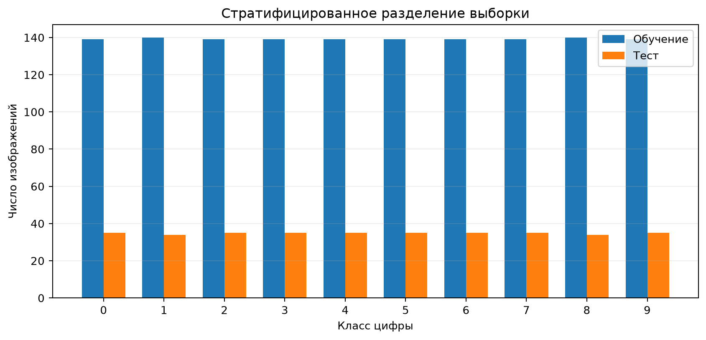
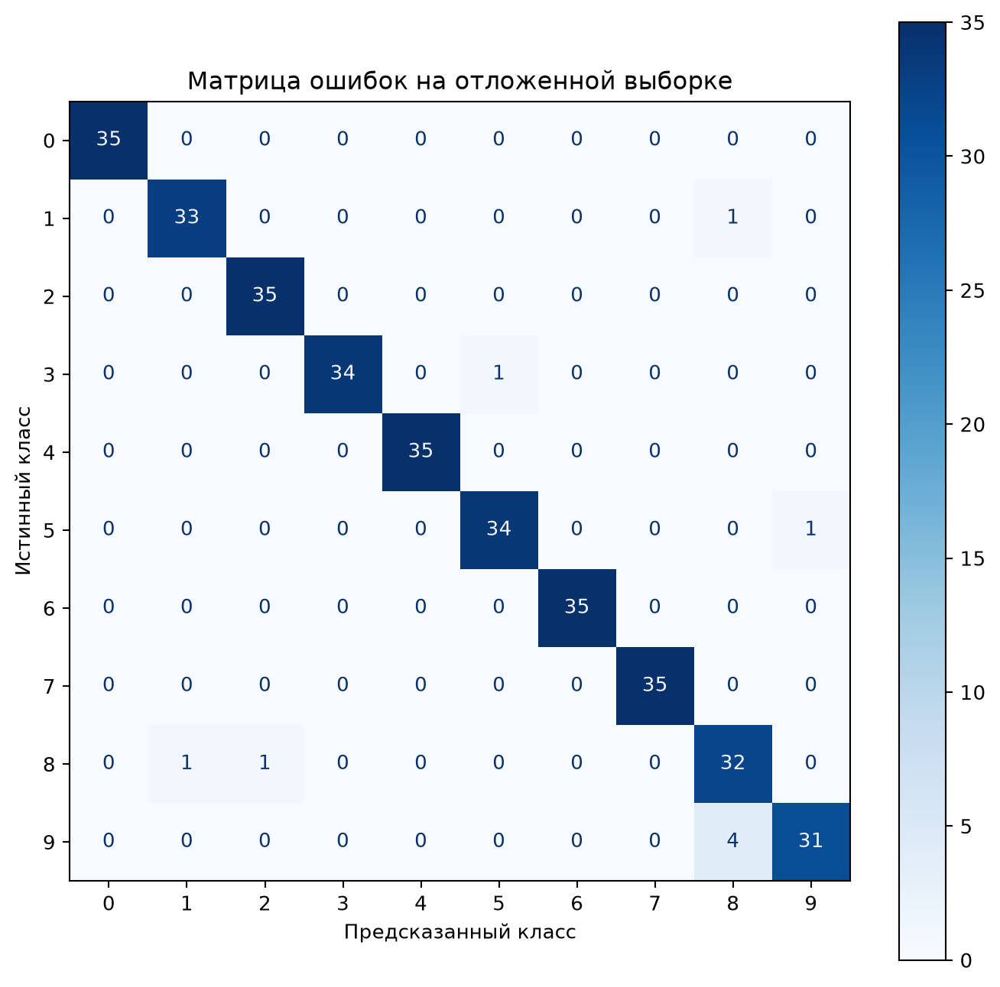
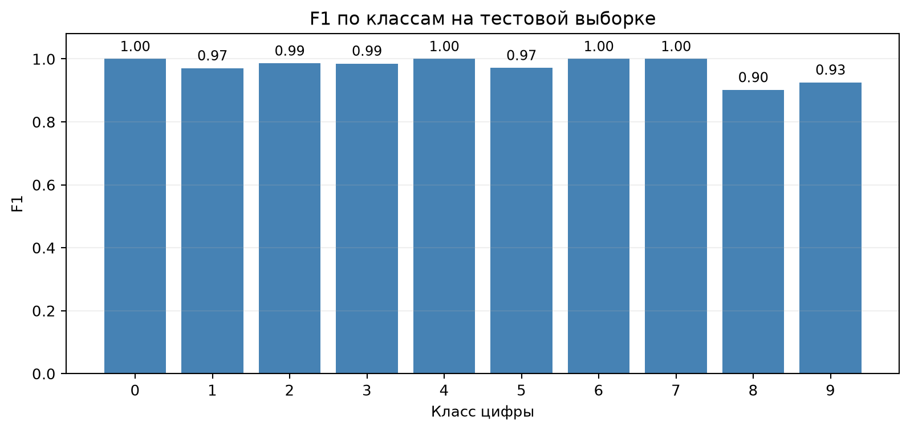
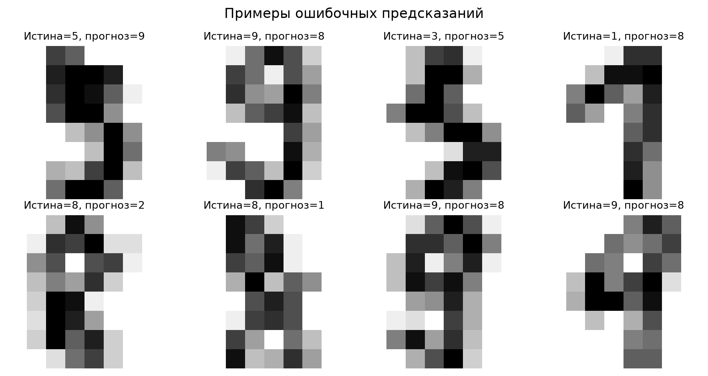
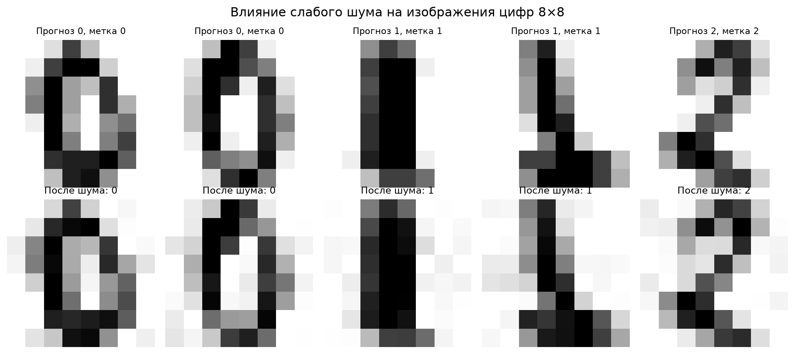
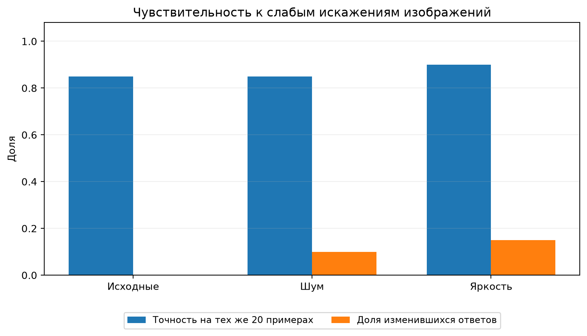
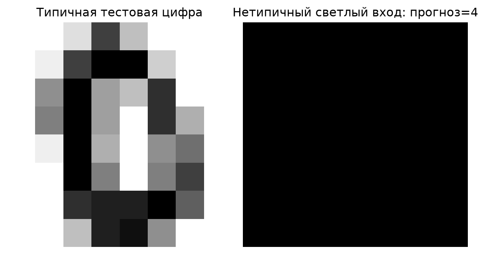

# Лабораторная работа № 2

## Построение базовой ML-модели и проверка устойчивости входных данных

| Параметр | Значение |
|:--|:--|
| Дисциплина | «Киберустойчивость систем искусственного интеллекта» |
| Выполнил | Серко Сергей Игоревич, группа N4270 |
| Направление | Computer Vision — классификация рукописных цифр |
| Предыдущий этап | [Лабораторная работа № 1](README.md) |
| Исследовательский ноутбук | [02_baseline_and_robustness.ipynb](notebooks/02_baseline_and_robustness.ipynb) |

В лабораторной работе построен базовый классификатор рукописных цифр на подготовленном в ЛР № 1 наборе Digits. Оценены качество на отложенной тестовой выборке, корректность обработки входных данных и чувствительность к небольшим искажениям изображений. Исходные данные и контрольные суммы первого этапа сохранены.

| Показатель | Результат |
|:--|--:|
| Объекты рабочего набора | **1740** (по 174 на класс) |
| Обучающая / тестовая выборки | **1392 / 348** (80/20, stratified, seed 42) |
| **Accuracy** базовой модели | **97,41 %** (339 из 348) |
| **Macro Precision / Recall / F1** | **0,9748 / 0,9740 / 0,9740** |
| Accuracy наивного классификатора | **9,77 %** |
| Ошибочные предсказания на тесте | **9** |
| Автоматические тесты | **33 из 33 пройдены** |
| Bandit (анализ `src/`) | **0 обнаруженных проблем** |

Показатели подтверждаются сохранёнными [метриками](metrics/baseline.json), [ноутбуком](notebooks/02_baseline_and_robustness.ipynb) и [протоколами проверок](reports/evidence/).

## 1. Что реализовано

1. **Проверка источника и целостности:** два CSV файла проверяются по точным SHA256 из ЛР № 1. Дополнительно анализируются заголовки столбцов, типы данных, пропуски, дубликаты, значения пикселей, метки и распределения классов.
2. **Разделение:** 80%/20%, фиксированный `random_state=42`, стратификация по десяти классам. Изображения из теста не участвуют в настройке параметров модели. Проверяется отсутствие совпадающих строк/векторов между частями.
3. **Модель:** конвейер `StandardScaler` → `LogisticRegression`. Нормализация обучается **только на обучающей части**. Подбор гиперпараметров по тестовой части не проводится.
4. **Метрики:** accuracy, macro/weighted Precision, Recall и F1, оценки по каждому классу, матрица ошибок, несколько ошибочных изображений; для сравнения — `DummyClassifier` (самый частый класс).
5. **Единый вход для предсказаний:** `src/inference.py`, явная проверка данных **до** вызова модели; та же функция используется в тестах и при итоговой оценке.
6. **Автоматические проверки:** `pytest` с положительными и многочисленными отрицательными случаями, включая запрет вызова модели при некорректном вводе.
7. **Устойчивость:** 20 тестовых объектов (по два из каждого класса), слабый гауссов шум и небольшое изменение яркости; отдельный нетипичный пример — полностью светлая матрица 8×8.
8. **Защита и артефакты:** локальный Jupyter, SSH-туннель, SHA256 модели, проверка перед десериализацией `joblib`, Bandit для модулей `src/`, зафиксированные параметры, версии и графики.

## 2. Результаты исследования и визуализации

Визуализации построены программно на данных текущего проекта; изображения размещены в каталоге [`reports/figures/`](reports/figures/). Под каждым рисунком приведена интерпретация полученного результата.

### 2.1. Распределение классов после разделения



*Рисунок 1 — Число изображений каждого класса в обучающей и тестовой выборках.*

Исходный рабочий набор строго сбалансирован: десять классов содержат по 174 изображения. Стратифицированное разделение 80/20 сохраняет близкие доли классов: в тестовой части по 34 или 35 изображений соответствующей цифры. Масштабирование признаков настраивается только по обучающим объектам.

### 2.2. Матрица ошибок



*Рисунок 2 — Матрица ошибок на 348 отложенных изображениях: строки соответствуют истинным меткам, столбцы — предсказанным.*

Диагональ содержит **339** правильных ответов; за её пределами находятся **9** ошибок. Наиболее частая путаница — цифра **9**, определённая как **8** в четырёх случаях. Это согласуется с визуальной схожестью некоторых написаний на матрице размером 8×8.

### 2.3. Метрика F1 по классам



*Рисунок 3 — F1-score каждого из десяти классов на тестовой выборке.*

Макроусреднённая F1 равна **0,9740**. Более низкие значения получены для классов **8** (примерно **0,9014**) и **9** (примерно **0,9254**); это видно и по матрице ошибок. Оценка по классам важна: одна только общая Accuracy скрывает, какие цифры распознаются хуже.

### 2.4. Примеры ошибочных предсказаний



*Рисунок 4 — Примеры неправильно классифицированных цифр с истинными и предсказанными метками.*

На рисунке показаны реальные ошибки на отложенной выборке. Неоднозначность небольших изображений и сходство отдельных штрихов объясняют, почему линейный классификатор не достигает стопроцентной точности. Эти изображения служат материалом для дальнейшего анализа ошибок.

### 2.5. Примеры изменённых изображений



*Рисунок 5 — Визуальное сравнение исходных и изменённых изображений из тестовой выборки.*

Для эксперимента использованы **20** объектов (по два каждого класса). К интенсивностям добавлялся слабый гауссов шум с параметром **σ = 0,8**, либо выполнялось повышение яркости на **0,6**; значения ограничивались интервалом **[0; 16]**. Истинные метки при этих преобразованиях предполагались неизменными.

### 2.6. Изменение качества и предсказаний



*Рисунок 6 — Сопоставление точности и доли изменившихся предсказаний на 20 изображениях.*

| Вариант | Accuracy на 20 объектах | Изменилось предсказаний относительно оригинала |
|:--|--:|--:|
| Без искажений | 85 % | 0 из 20 (0 %) |
| Гауссов шум | 85 % | 2 из 20 (10 %) |
| Повышение яркости | 90 % | 3 из 20 (15 %) |

Даже при допустимом диапазоне пикселей ответы модели могут меняться. Незначительное улучшение точности после изменения яркости на малой подвыборке **не доказывает**, что такое преобразование полезно для всех изображений.

### 2.7. Проверка нетипичного входа



*Рисунок 7 — Полностью светлая матрица 8×8 и результат её обработки.*

Вход удовлетворяет требованиям к форме и диапазону значений, поэтому проходит формальную валидацию; классификатор возвращает класс **4**. Вместе с тем расстояние до ближайшего обучающего изображения составляет **91,66**, тогда как 95-й процентиль таких расстояний для тестовых данных — **24,08**. Это указывает на нетипичность изображения по выбранной метрике, но само по себе не является универсальным OOD-детектором. Следующее направление развития — механизм отказа от предсказания для необычных объектов.

---

## 3. Как возобновить работу после отключения VirtualBox

### 3.1. Windows и VirtualBox

1. Запустить Oracle VirtualBox → `CyberAI-Ubuntu` → **Start/Запустить**.
2. Открыть **PowerShell на Windows**, подключиться по прежнему ключу:

```powershell
ssh -i "$env:USERPROFILE\.ssh\id_ed25519_lab1" -p 2222 mluser@127.0.0.1
```

Подключение выполняется к локальному порту Windows `2222` (перенаправление VirtualBox на SSH-порт Ubuntu `22`). При необходимости введите **парольную фразу вашего ключа**, не пароль удалённого пользователя.

3. В открывшемся терминале Ubuntu активировать существующий Python:

```bash
cd /home/mluser/ml-project
source .venv/bin/activate
python --version
sha256sum -c integrity/datasets.sha256
```

Должны появиться `(.venv)` и две строки с `OK`. Если файл `.venv` не найден, восстановите его из существующего `requirements.txt`, но только после проверки пути проекта:

```bash
cd /home/mluser/ml-project
python3 -m venv .venv
source .venv/bin/activate
python -m pip install -r requirements.txt
```

Если SSH недоступен, войдите через окно VirtualBox пользователем `sergo`, откройте терминал, проверьте `sudo systemctl status ssh`, а затем откройте сеанс `mluser` командой `su - mluser`. **Не меняйте запрет парольного SSH-входа и не выключайте UFW ради диагностики.**

### 3.2. Как перенести новые файлы лабораторной

Сохраните предоставленный архив `lab2_additions.zip` в папку **Загрузки** Windows. Оставив VM включённой, откройте **второе окно Windows PowerShell** и выполните:

```powershell
scp -i "$env:USERPROFILE\.ssh\id_ed25519_lab1" -P 2222 "$env:USERPROFILE\Downloads\lab2_additions.zip" mluser@127.0.0.1:/home/mluser/
```

В терминале Ubuntu:

```bash
cd /home/mluser/ml-project
sudo apt install -y unzip   # только если unzip ещё не установлен
unzip -o /home/mluser/lab2_additions.zip
source .venv/bin/activate
bash scripts/prepare_lab2.sh
```

Архив содержит **новые материалы ЛР № 2**. В нём намеренно нет `data/`, `README.md`, `.gitignore` и старого `requirements.txt`, поэтому старые файлы ЛР № 1 не затираются. Скрипт `prepare_lab2.sh` проверяет SHA256 исходных CSV, добавляет в старый README ссылку на эту инструкцию, устанавливает Bandit/pytest и обновляет список установленных зависимостей. Содержимое данных и прежний эталон SHA256 он не изменяет; права на локальные CSV и каталог модели ужесточаются (данные: `600`, каталоги: `700`).

### 3.3. Полный запуск одной командой

```bash
cd /home/mluser/ml-project
source .venv/bin/activate
bash scripts/run_lab2.sh
```

Скрипт последовательно выполняет: контроль SHA256 данных → обучение → вычисление метрик и построение 4 графиков → эксперимент устойчивости и 3 дополнительных графика → реальные результаты проверок входа → `pytest` → **Bandit** → SHA256 модели → загрузку модели и контрольный прогноз. Команда завершится ошибкой, если какой-либо обязательный этап завершится неуспешно. Не прячьте или не удаляйте ошибки в журнале.

Для отдельного запуска этапов:

```bash
python -m src.train
python -m src.robustness
python -m src.validation_cases
python -m pytest tests/ -q
python -m bandit -r src/
sha256sum -c integrity/model.sha256
python -m src.verify
python -m src.package_model_private
python -m src.cli --demo
```

### 3.4. JupyterLab через SSH, без открытия внешнего порта

В терминале Ubuntu (от `mluser`, в активном `.venv`):

```bash
cd /home/mluser/ml-project
jupyter lab --no-browser --ip=127.0.0.1 --port=8888
```

В новом окне Windows PowerShell:

```powershell
ssh -i "$env:USERPROFILE\.ssh\id_ed25519_lab1" -p 2222 -N -L 127.0.0.1:8890:127.0.0.1:8888 mluser@127.0.0.1
```

В браузере Windows открыть `http://127.0.0.1:8890/lab`, при запросе ввести токен, показанный **только локально** в терминале Jupyter. Открыть `notebooks/02_baseline_and_robustness.ipynb` → **Run → Run All Cells**.

**Безопасность:** сервер Jupyter слушает только `127.0.0.1` на гостевой VM. Порт 8888 не публикуется в VirtualBox. Не отключайте токенную аутентификацию, не раскрывайте токены в скриншотах, Git, отчёте или переписке. Для проверки `ss -ltnp | grep 8888` должен показать `127.0.0.1:8888`. Когда Jupyter уже запущен, выполните `bash scripts/check_vm_security.sh`: вывод о пользователе, настройках SSH, UFW, правах файлов и локальной привязке Jupyter сохранится без секретов в `reports/evidence/lab2_vm_security.txt`. Скрипт не заменяет проверки токенной аутентификации.

## 4. Предобработка и ограничение входов

Поддерживаемые формы числового входа: один объект `8×8`, плоский вектор `64`, пакет `N×8×8` или `N×64`. Все значения должны быть конечными вещественными числами в диапазоне **[0, 16]**. Строки, `NaN`, `Inf`, отрицательные числа, несоответствующие формы и другие объекты отклоняются с понятной ошибкой `InputValidationError`.

- Размер пакета: **от 1 до 32 изображений**; при тестировании можно задать меньший искусственный предел.
- После загрузки массива: максимум **2048 элементов** / **16 КиБ** данных в формате `float64`.
- При локальном запуске из JSON: размер файла проверяется **до чтения и декодирования**, предел **128 КиБ** (`src/cli.py`). Функция `predict_request()` принимает уже декодированный объект; будущий HTTP-сервис в ЛР № 4 обязан ограничить байты запроса **до его разбора**.
- Файлы PNG/JPEG не принимаются напрямую: входной контракт только числовая матрица. Это исключает необоснованную обработку непроверенных медиакодеков. Позже для изображений можно реализовать отдельную контролируемую декодировку.
- Функция сначала валидирует всё, только затем вызывает `.predict()`. Негативные тесты используют модель-шпион со счётчиком вызовов.

Пример произвольного корректного JSON-файла для `python -m src.cli --json input.json`:

```json
{"pixels": [[0,0,0,0,0,0,0,0],[0,0,0,0,0,0,0,0],[0,0,0,0,0,0,0,0],[0,0,0,0,0,0,0,0],[0,0,0,0,0,0,0,0],[0,0,0,0,0,0,0,0],[0,0,0,0,0,0,0,0],[0,0,0,0,0,0,0,0]]}
```

Здесь нулевая матрица **не обязана быть настоящей цифрой**: она демонстрирует лишь корректный формат. Система пока не умеет отказываться от предсказания для нетипичного изображения.

## 5. Где находятся результаты

| Место | Содержимое |
| --- | --- |
| `src/data.py` | Проверки CSV, анализ распределения и разделение. |
| `src/train.py` | Обучение, сравнение с фиктивным классификатором, метрики и сохранение модели. |
| `src/inference.py` | Единственная точка предсказания, ограничения входа, контроль перед загрузкой модели. |
| `src/robustness.py` | Шум, изменение яркости, нетипичный вход, числовые результаты. |
| `src/figures.py` | Генерация 7 PNG-графиков (подписи на русском). |
| `src/validation_cases.py`, `tests/` | Результаты негативных/положительных тестов и автоматические тесты. |
| `metrics/baseline.json` | **Главная опорная метрика** для ЛР № 3: название метрики, значение, тестовая выборка и версия CSV. |
| `metrics/data_quality.json` | Отчёт о качестве исходного и сбалансированного датасета. |
| `metrics/training_config.json` | Гиперпараметры, версия Python/библиотек и время обучения. |
| `metrics/robustness.json` | Числа по каждому искажению, реакция на нетипичный вход. |
| `metrics/validation_cases.json` | **Фактические** входы/ожидания/результаты проверок. |
| `metrics/split_indices.json` | Сохранённые индексы train и test, чтобы проверить повторяемость. |
| `reports/figures/` | **7 готовых рисунков PNG**, которые позже вставим в отчёт по ГОСТ. |
| `reports/evidence/lab2_*.txt` | Журналы выполнения скриптов, `pytest`, Bandit, SHA256, контроля SSH/UFW и проверки модели. |
| `models/digits_baseline.joblib` | Модель **вместе с обученной нормализацией**. Загружать только собственный проверенный файл! |
| `integrity/model.sha256` | Контрольная сумма файла модели; при переобучении корректно обновляется. |
| `notebooks/02_baseline_and_robustness.ipynb` | Последовательность всех шагов с русскими пояснениями и графиками. |

## 6. Защита данных и модели при публикации

Установка модели в Git **не включается автоматически**. В ЛР № 1 правило `.gitignore` исключало `models/*.joblib`; оно сохраняется. Несмотря на небольшой размер и учебный характер файла, задание запрещает размещать модель, данные, пароли и токены в открытых каталогах и репозиториях.

**Для сдачи используйте один из вариантов:** (а) закрытый GitHub-репозиторий с предоставленным преподавателю доступом и моделью внутри; (б) код/ноутбук в репозитории, а файл модели, `integrity/model.sha256` и параметры обучения — **отдельным вложением в личном кабинете курса** или по другой приватной ссылке преподавателю. Архив `lab2_model_private.zip` создаётся командой `python -m src.package_model_private` (а также в конце `scripts/run_lab2.sh`) **после локального обучения**; он не публикуется в Git. Для передачи преподавателю скачайте этот архив с VM командой `scp` и приложите к ответу в учебном портале. Для совместной сдачи ЛР № 1 и ЛР № 2 используется приватный репозиторий. Следует помнить, что изменение видимости не удаляет копии, которые могли быть сделаны ранее.

`joblib` — формат на основе pickle. Проверка SHA256 до загрузки обнаруживает изменение файла относительно известного эталона, **но не подтверждает подлинность**, если злоумышленник может заменить и модель, и манифест. Для реальной защиты храните доверенный эталон хэша отдельно (например, в переданном лично преподавателю отчёте/артефакте) и не загружайте скачанные от неизвестных авторов `.joblib`.

## 7. Иллюстрации и доказательства для будущего отчёта

Список рисунков, включённых в раздел 2 и сохраняемых в `reports/figures/`:

1. `lab2_01_class_split.png` — распределение train/test.
2. `lab2_02_confusion_matrix.png` — матрица ошибок.
3. `lab2_03_f1_by_class.png` — F1 по каждому классу.
4. `lab2_04_wrong_predictions.png` — примеры ошибок модели.
5. `lab2_05_noise_examples.png` — изображения до и после слабого шума.
6. `lab2_06_robustness.png` — изменение качества и доли изменившихся ответов.
7. `lab2_07_atypical_input.png` — нетипичная матрица 8×8.

После локального запуска в Ubuntu дополнительно сохраните **собственные, реальные скриншоты**: (а) `sha256sum -c integrity/datasets.sha256`; (б) `(.venv)` и статус SSH; (в) `ss -ltnp | grep 8888` и рабочую страницу Jupyter **без токена**; (г) вывод обучения с метриками; (д) `pytest ... -q`; (е) `bandit -r src/`; (ж) `sha256sum -c integrity/model.sha256`; (з) открытый ноутбук с графиками. При написании отчёта иллюстрации оформляются подписями вида «Рисунок 1 — ...», с обязательными ссылками на них в тексте. Для итогового отчёта используются только фактические результаты выполнения и снимки экрана без токенов или приватных ключей.

## 8. Проверка статическим анализатором и ограничение среды

Запуск `python -m bandit -r src/` обязателен в твоём `.venv`. Его реальный вывод сохраняется в `reports/evidence/lab2_bandit.txt`. При обнаружении проблем исправьте код, а предупреждения по доверенной десериализации обоснуйте отдельным пояснением, не скрывая предупреждения. При выполнении в Ubuntu Bandit завершился без обнаруженных проблем; протокол сохранён в `reports/evidence/lab2_bandit.txt`.

## 9. Коммит и отправка

Перед добавлением в Git проверьте файлы, которые действительно отправятся:

```bash
git status --short
git check-ignore models/digits_baseline.joblib
```

Команда `git check-ignore` должна показать путь модели, если она остаётся вне публичного Git. Не выполняйте `git add -f models/digits_baseline.joblib` в публичном репозитории. Добавляйте изменения из ЛР № 2 выборочно, просмотрите `git diff --cached --stat`, затем создайте коммит. Если выбран **приватный** репозиторий с доступом преподавателя и намеренно включаете модель, это должно быть отдельное осознанное решение.

Репозиторий ЛР № 1: https://github.com/Serega-Rodriguez-Sand-Kingovich/lab1-cyber-resilience

## 10. Методические ограничения

- Исходный файл содержит 1797 изображений; рабочая строго сбалансированная выборка из ЛР № 1 — 1740 (по 174 в каждом классе), 64 пикселя и метка `target`.
- В файле нет идентификаторов автора рукописи или исходной серии. Отсутствие перекрывающихся строк между train и test проверено, но **невозможно доказать разделение по авторам**. Поэтому итоговая оценка относится только к указанному разбиению учебного датасета.
- Для модели задана фиксированная конфигурация; отдельный подбор гиперпараметров на тесте не проводился.
- Тестовая выборка содержит 348 объектов. Результаты могут не отражать качество на фотографиях документов, иных стилях почерка и другом распределении.
- Эксперимент с 20 изображениями — небольшой тест чувствительности, **а не доказательство устойчивости ко всем атакам**.
- Проверка формата `8×8` и диапазона `[0, 16]` не означает, что изображение является настоящей цифрой.
- Сохранённая модель и метрики нужны для ЛР № 3 и ЛР № 4; их нельзя подменять результатами нового обучения без обновления версий.
