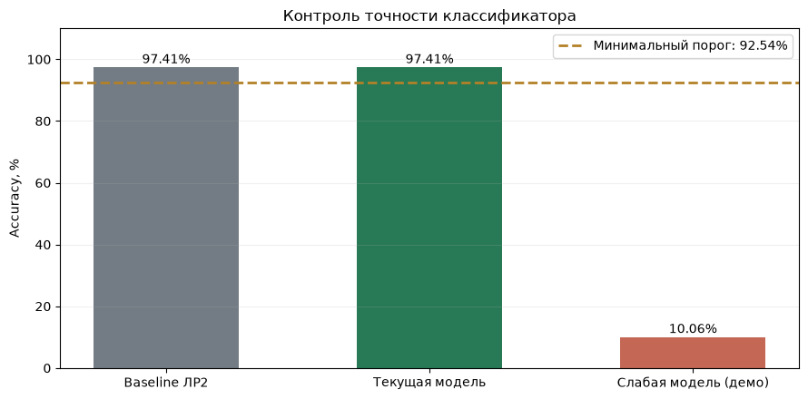
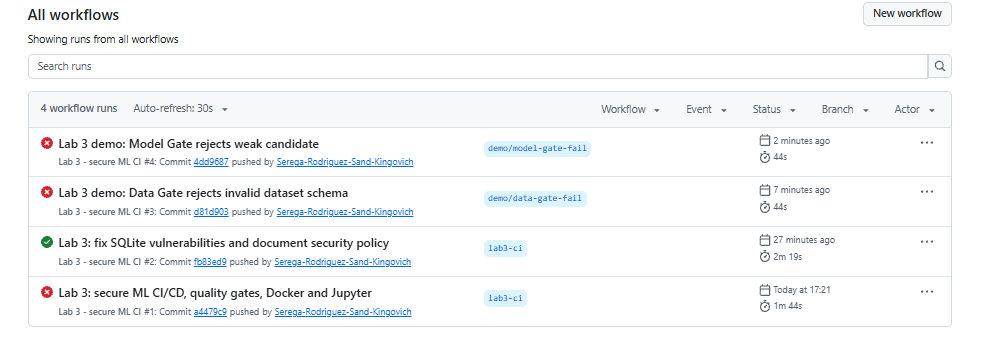

# Лабораторная работа 3. Тестирование и CI

Серко Сергей Игоревич, группа N4270. Университет ИТМО, 2026.

Для модели из ЛР № 2 настроены автоматические проверки кода, входных данных, качества классификатора, зависимостей и Docker-образа. Проверялось не только успешное прохождение конвейера, но и его способность остановить работу при преднамеренно внесённом нарушении.

## Проверка Python-кода

Использованы три инструмента:

| Инструмент | Что проверяется |
|---|---|
| `pytest` | Предсказания, граничные значения входов, целостность файлов, правила Data/Model/Security Gate |
| `Ruff` | Синтаксис, импорты и нарушения выбранных правил оформления Python |
| `Bandit` | Потенциально опасные конструкции исходного кода |

Тесты проверяют и корректное поведение, и управляемые отказы. Например, невалидная матрица отклоняется до передачи в модель, а ошибка SHA256 препятствует загрузке недоверенного артефакта.

С сохранением тестов ЛР № 2–3 базовый набор составил 75 случаев. После добавления 21 API-проверки в ЛР № 4 полный набор содержит 96 тестов, все они прошли в итоговом запуске.

## Data Gate

Проверка данных реализована в [`scripts/data_gate.py`](scripts/data_gate.py), правила — в [`config/data_quality_policy.json`](config/data_quality_policy.json).

| Контроль | Требование |
|---|---|
| Источник | `data/digits.csv` с закреплённым SHA256 |
| Схема | 64 столбца `pixel_*` и метка `target` |
| Размер | 1 740 строк |
| Баланс классов | 174 изображения для каждой цифры |
| Значения | Числа в диапазоне 0–16, без NaN и Inf |
| Метки | Только классы 0–9 |

Для негативной проверки использовалась копия CSV с удалённым столбцом `pixel_0_0`. Проверка отклонила файл из-за нарушения схемы. Исходный рабочий датасет не изменялся.

## Model Gate

В [`scripts/model_gate.py`](scripts/model_gate.py) качество проверяется на закреплённой тестовой части ЛР № 2. При сравнении применяется метрика Accuracy.

| Показатель | Значение |
|---|---:|
| Базовая Accuracy ЛР № 2 | 0,9741379310 |
| Разрешённое относительное снижение | 5 % |
| Минимальная Accuracy | 0,9254310345 (92,54 %) |
| Проверенная модель | 97,41 % — допущена |
| Намеренно слабый кандидат | 10,06 % — отклонён |



*Сравнение исходной, проверяемой и слабой моделей.*

Слабый кандидат использовался только в отдельном демонстрационном запуске. Базовая модель и её контрольные метрики не заменялись. Правила порога находятся в [`config/model_quality_policy.json`](config/model_quality_policy.json).

## Аудит зависимостей и Security Gate

Runtime-зависимости проверяются через `pip-audit`, исходный код — Bandit, контейнер — Trivy. Результаты анализирует [`scripts/security_gate.py`](scripts/security_gate.py). Критические уязвимости и ошибки сканирования блокируют обязательный CI; неполные результаты не трактуются как успешная проверка.

Для отдельной проверки использован тестовый отчёт с записью `CRITICAL`; Security Gate вернул код `1`. Этот сценарий проверяет правило остановки, а не доказывает наличие реальной критической уязвимости в проекте. Fixture теста: [`tests/fixtures/security_gate_critical_example.json`](tests/fixtures/security_gate_critical_example.json).

### SQLite в Docker-образе

В ходе настройки Trivy были обнаружены шесть записей уровня `UNKNOWN`, относящихся к `libsqlite3-0`. В образе используется версия `3.54.1-2`. Для конкретных CVE, пакета и версии создана ограниченная политика исключений [`config/sqlite_exception_policy.json`](config/sqlite_exception_policy.json), срок действия — до 5 декабря 2026 года.

Оригинальные результаты Trivy сохраняются; исключения применяются только на уровне принятия решения Security Gate. Для новых или иных находок исключение не действует. Это временная политика, а не подтверждение отсутствия уязвимостей.

## GitHub Actions

Конвейер находится в [`.github/workflows/ci.yml`](.github/workflows/ci.yml) и запускается при push в настроенные ветки, Pull Request и вручную. Используется `ubuntu-24.04`, Python 3.12, закреплённые версии инструментов и ограниченные права токена.

Основная последовательность:

1. Получение исходников, контроль SHA256, установка зависимостей и `pip check`.
2. Ruff, Bandit, Pytest и `pip-audit`.
3. Data Gate и Model Gate.
4. Сборка Docker-образа, Trivy, Security Gate и проверка Dockerfile.
5. Непривилегированный запуск контейнера, проверка UID и HTTP smoke-тесты.
6. Сохранение диагностических результатов, включая случаи отказа.

После ЛР № 4 к существующему pipeline добавлены реальные API-тесты, проверка `/health`, `/predict` и `/metrics`. Всего в итоговой версии workflow предусмотрено 20 этапов. Артефакты CI содержат отчёты тестирования, контрольные суммы, параметры запуска и результаты сканирования.



*История запусков: ошибка первичной проверки, исправленная версия и отдельные эксперименты отказа.*

История доступна в [GitHub Actions репозитория](https://github.com/Serega-Rodriguez-Sand-Kingovich/lab1-cyber-resilience/actions).

## Docker и запуск без root

В Dockerfile описан образ на Python 3.12 с непривилегированным пользователем `app` (UID/GID `10001`). Во время сборки устанавливаются необходимые библиотеки, а приложение работает без прав `root`. Используются ограничения памяти, процессов и Linux capabilities; API публикуется только на loopback хоста.

Проверка контейнера выполняется в CI и локально. В финальной версии ЛР № 4 дополнительно запускается `/health` для настоящего API; подробная команда приведена в [README ЛР № 4](README_LAB4.md).

## Локальные проверки и результаты

```bash
cd ~/ml-project
source .venv/bin/activate
sha256sum -c integrity/datasets.sha256
sha256sum -c integrity/model.sha256
python -m ruff check src/ tests/ scripts/
python -m bandit -r src/ -q
python -m pytest tests/ -q
python scripts/data_gate.py --report reports/data_gate.json
python scripts/model_gate.py --report reports/model_gate.json
```

Файлы `reports/data_gate.json` и `reports/model_gate.json` в примере создаются при запуске; заранее в репозитории они не хранятся. Итоги вычислений, отрицательные сценарии и график качества сохранены в [`notebooks/03_lab3_secure_cicd.ipynb`](notebooks/03_lab3_secure_cicd.ipynb).

Команды негативных проверок из ноутбука:

```bash
python scripts/model_gate.py --demo-weak-candidate \
  --report reports/lab3/notebook_model_gate_weak.json
python scripts/security_gate.py \
  --report tests/fixtures/security_gate_critical_example.json \
  --output reports/lab3/notebook_security_gate_fail.json
```

Для обоих случаев ожидался код завершения `1`: проверка должна отклонить неприемлемый результат. Сканирование реального образа Trivy выполнялось отдельно.
