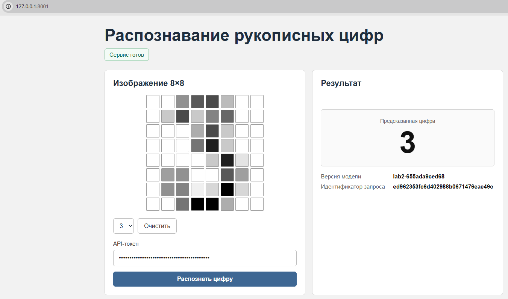
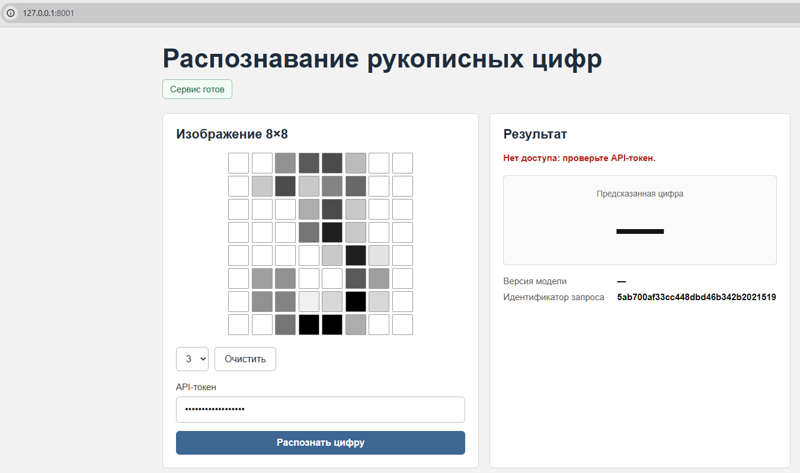
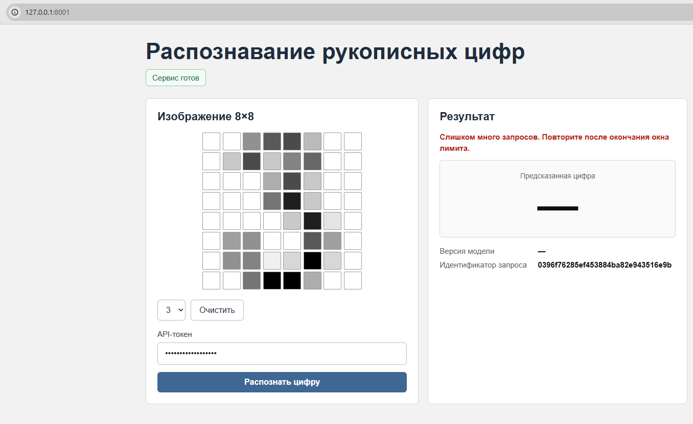
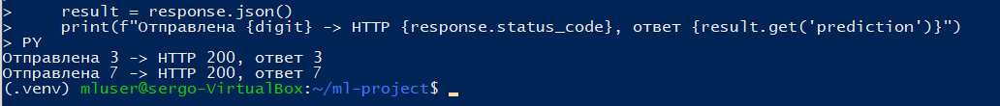
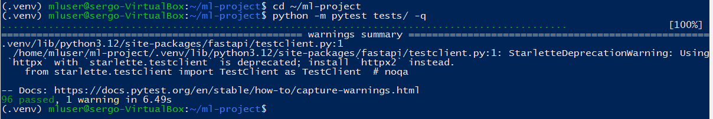
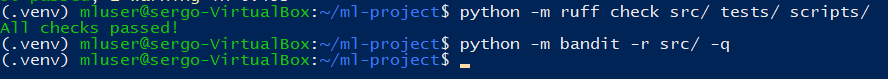
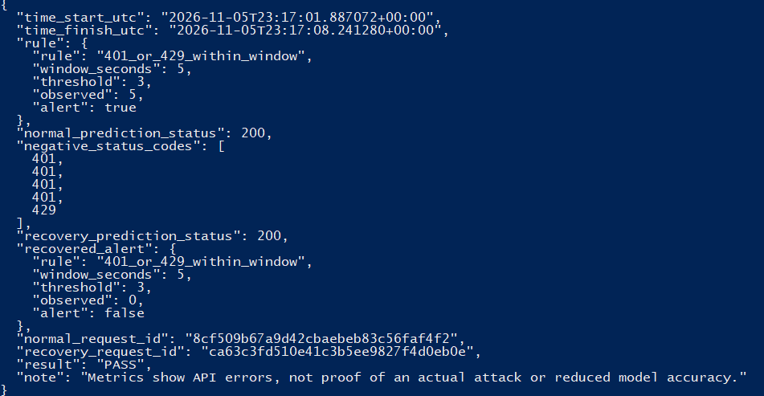
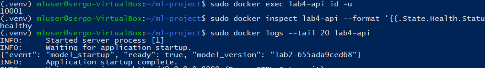
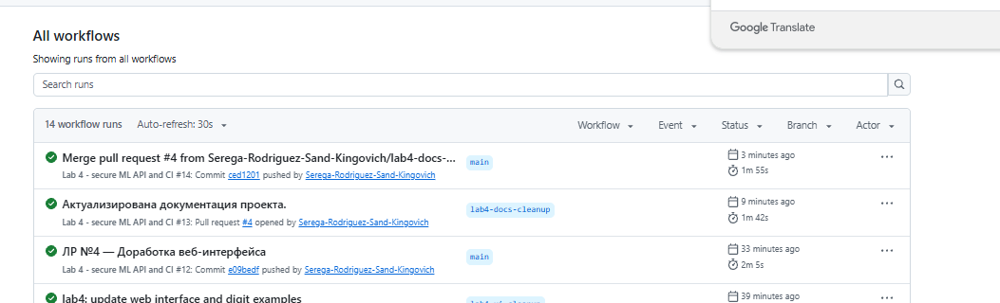

# Лабораторная работа 4. Защищённый API и мониторинг

Серко Сергей Игоревич, группа N4270. Университет ИТМО, 2026.

Сохранённая модель ЛР № 2 развёрнута как локальный HTTP-сервис. Для неё реализованы веб-страница, аутентификация, проверка входных данных, ограничения ресурсов, структурированные логи и метрики. На контролируемой серии ошибочных запросов проверены обнаружение отказов и последующее восстановление.

Версия классификатора — `lab2-655ada9ced68`.

## Сервис и загрузка модели

API написан на FastAPI, сервер — Uvicorn. При запуске приложение проверяет SHA256 `models/digits_baseline.joblib` по закреплённому эталону, `integrity/model.sha256` и сведениям в `metrics/baseline.json`. Лишь затем выполняется десериализация через проверенную функцию ЛР № 2.

Модель загружается один раз при старте и передаётся в отдельный дочерний процесс предсказания (`multiprocessing`, `Pipe`). Если контрольная сумма неверна или загрузка не удалась, `/health` отвечает 503, а не `healthy`.

Проверка SHA256 подтверждает совпадение с сохранённой версией, но не делает безопасной загрузку произвольного pickle/joblib. Маршрута для загрузки пользовательской модели нет.

## API

| Маршрут | Назначение | Доступ |
|---|---|---|
| `GET /` | Веб-интерфейс | Открытый |
| `POST /predict` | Классификация изображения или пакета | `Authorization: Bearer <token>` |
| `GET /health` | Готовность модели, 200 или 503 | Открытый |
| `GET /metrics` | Счётчики и гистограмма для Prometheus | `X-Metrics-Token` |
| `GET /detection` | Состояние правила обнаружения | `X-Metrics-Token` |

`POST /predict` принимает JSON с одним полем `pixels`. Поддерживается матрица `8×8`, вектор из 64 чисел либо пакет до 32 изображений. Каждый пиксель — конечное число от 0 до 16. Для корректного одиночного запроса результат содержит `prediction`, `predictions`, `model_version` и `request_id`.

Пример корректного тела запроса — один из образцов набора данных:

```json
{
  "pixels": [
    [0, 0, 5, 13, 9, 1, 0, 0],
    [0, 0, 13, 15, 10, 15, 5, 0],
    [0, 3, 15, 2, 0, 11, 8, 0],
    [0, 4, 12, 0, 0, 8, 8, 0],
    [0, 5, 8, 0, 0, 9, 8, 0],
    [0, 4, 11, 0, 1, 12, 7, 0],
    [0, 2, 14, 5, 10, 12, 0, 0],
    [0, 0, 6, 13, 10, 0, 0, 0]
  ]
}
```

`/health` публикует только `status` и `model_version`, без путей к файлам, секретов и сведений о внутреннем окружении.

## Валидация и ограничение ресурсов

Проверки выполняются на сервере до обращения к модели. Ограничение тела контролируется во время чтения `request.stream()`: одного заголовка `Content-Length` недостаточно.

| Проверка | Предел и реакция |
|---|---|
| Размер тела JSON | 24 KiB (24 576 байт); 413 |
| Чтение тела | 3 секунды; 408 |
| Число изображений | От 1 до 32; неправильная форма — 422 |
| Значения | 0–16, NaN и Inf запрещены; 400/422 |
| Формат тела | JSON; другой `Content-Type` — 415 |
| Одновременное вычисление | Один запрос; ожидание слота до 0,5 с, затем 503 |
| Выполнение модели | Deadline 3 с; при зависании дочерний процесс завершается, 503 |
| Частота запросов | По адресу клиента; после достижения лимита 429 |
| Аутентификация | Отсутствующий или неверный Bearer-токен — 401 |

При превышении deadline вычислительный процесс останавливается; `/health` переходит в состояние неготовности. После такого отказа требуется перезапуск приложения. Восстановление после кратковременного rate limit происходит без перезапуска.

## Аутентификация

Для `/predict` используется `APP_API_TOKEN`, для `/metrics` и `/detection` — отдельный `APP_METRICS_TOKEN`. Оба токена задаются через окружение и должны различаться. Секреты хранились вне Git в `~/.config/lab4/app.env` с правами `600`.

Токен не встраивается в HTML/JavaScript, не добавляется в URL и не пишется в логи. Веб-форма использует поле типа `password`. Сервис в Ubuntu доступен на loopback; подключение из Windows осуществлялось через SSH-туннель.

Ограничитель реализован для одного процесса и хранит время запросов в памяти по адресу клиента. По умолчанию задано 5 запросов за 60 с. Для демонстрации использовалось 5 запросов за 5 с. Такой limiter не синхронизирует состояние между несколькими Uvicorn workers и сбрасывается после перезапуска.

## Веб-интерфейс

Страница размещена в [`static/index.html`](static/index.html), стили — в [`static/style.css`](static/style.css), обработчики — в [`static/app.js`](static/app.js). Реализованы:

- сетка из 64 клеток с интенсивностями от 0 до 16;
- выбор реальных тестовых примеров цифр 0–9 из [`static/digit_examples.json`](static/digit_examples.json);
- ручное изменение яркости пикселей и очистка сетки;
- поле API-токена, отправка в `/predict`, отображение класса, версии и `request_id`;
- сообщения о неверном токене, некорректных данных, превышении лимита и недоступности сервиса.

Недоверенные значения выводятся через `textContent`, а не через `innerHTML`. Страница и API имеют один origin, поэтому отдельная CORS-настройка не потребовалась.



*Пример из тестовой выборки: модель вернула цифру 3.*



*Сообщение об ошибке доступа; поле результата пустое.*



*Обработка HTTP 429 после серии запросов.*

Ручной рисунок может распознаваться хуже, чем сохранённый образец из датасета: у модели нет отдельного класса «не знаю», а обучающие изображения отличаются от резко нарисованных фигур. В проверке сохранённой модели 10 выбранных образцов (по одному на класс) были распознаны правильно; через настоящий API отдельно проверены примеры 3 и 7 с ответами HTTP 200.



*Два запроса к `/predict`: HTTP 200, предсказания 3 и 7.*

## Тестирование

В [`tests/test_lab4_api.py`](tests/test_lab4_api.py) добавлен 21 HTTP-тестовый случай, включая параметризованные проверки. Вместе с 75 сохранёнными тестами ЛР № 2–3 выполнены 96 тестов.

Отдельно проверены: доступность страницы и `/health`, успешное предсказание, отсутствие токена, ошибки формы, неподдерживаемый тип данных, превышение размера, rate limiting, неверный SHA256 модели и неготовность после завершения зависшего вычисления. Для отвергнутых входов тесты контролируют, что вызов модели не выполняется.



*Локальный прогон: 96 тестов пройдены. Предупреждение TestClient не является отказом тестов.*

Локальные проверки после обновления интерфейса: Pytest — `96 passed`, Ruff — `All checks passed!`, Bandit — без найденных замечаний в использованной конфигурации.



## Журналы и метрики

Middleware записывает структурированные события с полями `ts`, `request_id`, `route`, `status`, `duration_ms`, `model_version`, `failure_type`. Значения токенов и входные пиксели в журнал не включаются.

`GET /metrics` экспортирует три семейства:

| Метрика | Значение |
|---|---|
| `lab4_requests_total` | Число ответов по маршруту и HTTP-коду |
| `lab4_request_duration_seconds` | Гистограмма длительности ответа |
| `lab4_rejections_total` | Число отклонений по причине отказа |

В labels метрик не включаются `request_id`, произвольный URL или текст запроса; это ограничивает число временных рядов. Сбором учитываются запросы, дошедшие до приложения, а не отказы на более раннем сетевом уровне.

## Обнаружение и восстановление

Контролируемый сценарий выполнен скриптом [`scripts/lab4_demo.py`](scripts/lab4_demo.py) на локальном сервисе. Параметры демонстрации: лимит 5 попыток за 5 с, тревога при 3 и более ответах 401/429 за 5 с.

| Этап | Результат |
|---|---|
| До негативной серии | Нормальное предсказание 200, `observed=0`, `alert=false` |
| Неверные токены | Четыре ответа 401 |
| Превышение лимита | Один ответ 429 |
| После серии | `observed=5`, `alert=true` |
| Через 6 секунд | Корректный запрос 200, `observed=0`, `alert=false` |

Интервал исходного эксперимента: 05.11.2026, 23:17:01–23:17:08 UTC, длительность около 6,35 с. Всего проверено семь запросов `/predict` в рамках последовательности `200 → 401 → 401 → 401 → 401 → 429 → 200`. HTTP-коды и `request_id` сопоставлены с JSON-событиями журнала.

Между снимками метрик (до запроса восстановления) счётчик `/predict` для `200` вырос с 1 до 2, для `401` — с 0 до 4, для `429` — с 0 до 1. Это шесть новых запросов; восстановление зафиксировано отдельно.



*Фрагмент фактического результата: коды запросов, тревога и восстановление.*

Получен результат `PASS`: после окончания окна ограничителя сервис снова ответил 200, а тревога исчезла. Это демонстрация реакций приложения на искусственную серию отказов, а не подтверждение внешней атаки или снижения точности классификатора.

Отдельные серверы Prometheus и Grafana не запускались. Реализованы совместимый с Prometheus endpoint, локальный журнал и прикладное правило `/detection`.

## Docker

Образ `ml-project:lab4` запускает сервис без root от UID/GID `10001`. В контейнер копируются runtime-зависимости, модель, исходный код и статическая страница. Применены `--read-only`, ограниченный `tmpfs`, `--cap-drop ALL`, `--security-opt no-new-privileges`, лимиты памяти 700 МБ и процессов 64. Порт публикуется только на `127.0.0.1` Ubuntu.



*UID 10001, Docker `healthy` и запуск проверенной модели.*

Параметры запуска в Ubuntu; порт 8000 был свободен:

```bash
sudo docker build --pull -t ml-project:lab4 .
sudo docker run -d --rm --name lab4-api \
  --read-only --tmpfs /tmp:rw,noexec,nosuid,size=16m \
  --cap-drop ALL --security-opt no-new-privileges \
  --pids-limit 64 --memory 700m \
  -p 127.0.0.1:8000:8000 \
  --env-file "$HOME/.config/lab4/app.env" \
  ml-project:lab4
curl -i http://127.0.0.1:8000/health
sudo docker exec lab4-api id -u
sudo docker inspect lab4-api --format '{{.State.Health.Status}}'
```

## Запуск и CI

Рабочий каталог в Ubuntu — `/home/mluser/ml-project`. Для воспроизведения запуска использовались разные секреты `APP_API_TOKEN` и `APP_METRICS_TOKEN` в `~/.config/lab4/app.env`; значения не включены в репозиторий. Демонстрационные лимиты задавались переменными `APP_RATE_LIMIT=5`, `APP_RATE_WINDOW=5`, `APP_DETECT_THRESHOLD=3`, `APP_DETECT_WINDOW=5`.

```bash
cd ~/ml-project
source .venv/bin/activate
set -a
source ~/.config/lab4/app.env
set +a
python -m uvicorn src.webapp:app \
  --host 127.0.0.1 --port 8000 --workers 1 \
  --limit-concurrency 16 --timeout-keep-alive 5 \
  --no-access-log --no-proxy-headers
```

Туннель из Windows PowerShell:

```powershell
ssh -N -o ExitOnForwardFailure=yes `
  -i "$env:USERPROFILE\.ssh\id_ed25519_lab1" `
  -p 2222 -L 127.0.0.1:8001:127.0.0.1:8000 `
  mluser@127.0.0.1
```

Адрес веб-страницы в браузере Windows — `http://127.0.0.1:8001/`.

```bash
python -m pytest tests/ -q
python -m ruff check src/ tests/ scripts/
python -m bandit -r src/ -q
sha256sum -c integrity/model.sha256
python scripts/lab4_demo.py
```

Общий workflow [`.github/workflows/ci.yml`](.github/workflows/ci.yml) сохраняет проверки ЛР № 3, добавляет HTTP-тесты, сборку API-контейнера и smoke-проверки. На сохранённом снимке запуски № 12 и № 14 в `main` завершились успешно.



*Итоговые успешные запуски GitHub Actions.*

`lab4_demo.py` записывает данные в `reports/lab4/`: `scenario_summary.json`, три файла `detection_*.json`, два файла `health_*.json` и снимки `metrics_before.prom` / `metrics_after.prom`. При повторном запуске эти файлы перезаписываются. Исходный эксперимент сохранялся отдельно в `lab4-evidence.tar.gz`; в этой копии репозитория приведены его снимки и результаты, а не сам архив.
